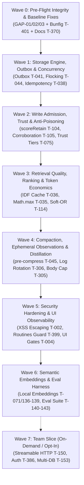

# 🛡️ Senior Technical Audit & Realigned Roadmap

> **Audit Authority**: Nexus (Quality Gate) & Muse (Chief Agency Orchestrator)  
> **Evaluation Date**: 2026-10-15  
> **Target Branch**: `dev` @ `ee7c40f`  
> **Test Status**: 649 pass, 0 fail (`bun test < /dev/null`), `tsc --noEmit` clean, 384 bundled modules  

---

## 1. Executive Summary & Audit Findings

A full agency-level senior developer and security audit of the Muse Memory codebase, test harness, documentation, and roadmap was conducted. 

While the test suite demonstrates clean execution (649/649 green) and 21 major architectural PRs (#57–#75) successfully landed on `dev`, several critical runtime traps, validation regressions, tracking drifts, and security gaps were uncovered:

### 🚨 Critical Vulnerabilities & Code Gaps Discovered

1. **Silent SQLite Initialization Crash & Fallback to Flat-Files (GAP-01)**:
   - **Location**: [`src/sqlite.ts:169-171`](file:///home/harsh/Projects/github/musememory/src/sqlite.ts#L169-L171) & [`src/store.ts:173-177`](file:///home/harsh/Projects/github/musememory/src/store.ts#L173-L177)
   - **Defect**: `initSchema` attempts `CREATE INDEX IF NOT EXISTS idx_memories_mem_path ON memories(mem_path)` unconditionally on existing tables. On stores created prior to v1, `memories` lacks `mem_path`. SQLite throws `SQLiteError: no such column: mem_path`.
   - **Impact**: `openStore` catches this error, swallows it, leaves `store.db` as `undefined`, and silently degrades to flat-file storage. Crucially, `runMigrations` in `src/migrate.ts` never executes for these stores.
   - **Remediation**: Guard index creation by inspecting existing columns via `PRAGMA table_info(memories)` or delegate index creation to `src/migrate.ts` migration `v1`.

2. **Stored-Command Validation Failure on Legacy Memories (GAP-02)**:
   - **Location**: [`.memory/memories/m_1791995990650_...yaml`](file:///home/harsh/Projects/github/musememory/.memory/memories/m_1791995990650_avoidneverre-invokebinsh-cformemorytest_commandexecutionb4.yaml#L36) & [`src/schema.ts`](file:///home/harsh/Projects/github/musememory/src/schema.ts)
   - **Defect**: Pre-`T-001` memory entries contain legacy `test_command` values (e.g. `grep -n 'bin/sh' src/verify.ts`). Following `T-001`'s template gating, `memory validate` and `memory doctor` exit with code 1 (`/test_command is not an executable command`).
   - **Impact**: Breaks automated health checks and CLI compliance.
   - **Remediation**: Add a stored-command doctor sweep/migration to sanitize non-template test commands.

3. **Terminal Hang on Interactive Stdin in Test Suite & Hooks (GAP-03)**:
   - **Location**: [`src/hooks/pack.ts:220-227`](file:///home/harsh/Projects/github/musememory/src/hooks/pack.ts#L220-L227)
   - **Defect**: `readStdinJson()` synchronously calls `readFileSync(0, "utf8")` without verifying whether stdin is a TTY.
   - **Impact**: When running in an interactive terminal or non-piped runner, `test/hooks.test.ts` blocks indefinitely waiting for EOF on fd 0.
   - **Remediation**: Guard with `if (process.stdin.isTTY) return {};` before attempting synchronous reads on fd 0.

4. **Plan & Tracking Drift (GAP-04)**:
   - 21 tickets landed on `dev` across PRs #57–#75 (`T-001`, `T-020`, `T-024-026`, `T-030-032`, `T-301`, `T-303`, `T-308`, `T-311`, `T-336-337`, `T-342`, `T-351`, `T-355`, `T-363`, `T-368`, `T-383`, `T-390`) but were left unchecked in `.agents/context/ticket-plan.md` and unrecorded in `current.md`.

---

## 2. Realigned Feature-Wave Roadmap (In-Line Cohesion)

To prevent context-switching across unrelated subsystems, all remaining tasks have been restructured into **7 In-Line Feature Waves**. Each wave groups tightly coupled files, tests, and dependencies into sequential, self-verifying delivery units:

---

### Wave 0 — Pre-Flight Integrity & Baseline Fixes (P0 · Immediate)
*Goal: Eliminate runtime regressions, fix doctor warnings, and ensure test-suite runs smoothly in any environment.*

- [ ] **T-402** · `initSchema` column-order fix: guard index creation on `mem_path`, `last_accessed_at`, `access_count` against missing columns so pre-v1 databases migrate smoothly (`src/sqlite.ts`).
- [ ] **T-403** · Stored-command doctor sweep: sanitize or migrate legacy non-template `test_command`s across stored YAML files (`.memory/memories/*.yaml`, `src/doctor.ts`).
- [ ] **T-404** · Stdin TTY decoupling: add `process.stdin.isTTY` check in `src/hooks/pack.ts:readStdinJson()` to prevent test runner hanging in interactive terminals.
- [ ] **T-401** · Bunfig surface hardening: configure explicit test runner timeout and isolation defaults (`bunfig.toml`).
- [ ] **T-370** · Documentation truth pass: align platform count (52 verified), tool count (107 tools), and version stamps (`README.md`, `.agents/context/current.md`).

---

### Wave 1 — Storage Engine, Outbox & Concurrency (P0 · In-Line Storage)
*Goal: Provide unbreakable queued writes, crash recovery, and multi-process file-locking without external daemons.*

- [ ] **T-041** · Outbox state machine (`pending` → `processing` → `sent` / `held` / `failed`) via additive migration `v3` (`src/migrate.ts`, `src/store.ts`).
- [ ] **T-042** · Stale-lock recovery sweep (300s) on store open (`src/store.ts`).
- [ ] **T-044** · Append-only fsync JSONL event log + single-writer flock (`src/store.ts`).
- [ ] **T-038** · `idempotency_key` column + UNIQUE constraint on capture (`src/migrate.ts`, `src/store.ts`).
- [ ] **T-040** · Normalized `content_hash` (whitespace/case) + dedup on propose (`src/store.ts`, `src/quality.ts`).
- [ ] **T-056** · `atexit` bounded join for async write workers (`src/store.ts`).
- [ ] **T-055** · Circuit breaker around store paths (5 failures → 120s cooldown → degraded mode) (`src/store.ts`).

---

### Wave 2 — Write Admission, Trust & Anti-Poisoning (P0/P1 · In-Line Trust)
*Goal: Guard memory intake against prompt injections, junk captures, and unverified promotions.*

- [ ] **T-104** · `scoreRetain` 0.3 write gate (refuses junk writes with low informational density) (`src/store.ts`).
- [ ] **T-105** · Corroboration-gated promotion (≥2 independent days, non-synthetic sources) (`src/promotion.ts`).
- [ ] **T-105b** · Syntax-only promotion rule: enforce AST/schema verification before candidate confirmation (`src/promotion.ts`).
- [ ] **T-075** · Ingest trust tiers (`trusted` | `candidate` | `untrusted`) by source type (`src/provenance.ts`, `src/types.ts`).
- [ ] **T-058** · Read-path re-validation: injection markup, credentials, and invisible characters excluded from recall (`src/retrieval.ts`).
- [ ] **T-103** · Index-time credential redaction keeping text searchable without secret leakage (`src/store.ts`).
- [ ] **T-391** · Citation validation: validate `source_ids` and `memory_ids` against live registry at write time (`src/claims.ts`, `src/mcp.ts`).

---

### Wave 3 — Retrieval Optimization, Ranking & Token Economics (P1 · In-Line Retrieval)
*Goal: Accelerate query speeds, eliminate scale crashes, and optimize token knapsack utilization.*

- [ ] **T-035** · Replace `Math.max(...arr)` spread crash at scale with iterative max (`src/retrieval.ts`).
- [ ] **T-036** · In-memory IDF caching across queries (`src/retrieval.ts`).
- [ ] **T-037** · Drop redundant full-list scan in `hybridSearch` (`src/retrieval/engine.ts`).
- [ ] **T-060** · Safe FTS5 query token escaping (quote every token to prevent syntax errors) (`src/store.ts`).
- [ ] **T-061** · Compound-token expansion (camelCase / snake_case splitting) (`src/retrieval.ts`).
- [ ] **T-070** · IDF-weighted relevance gate before FTS5 search (`src/retrieval.ts`).
- [ ] **T-114** · Soft-OR evidence fusion formula `P = 1 - (1 - pv)(1 - pl)` (`src/retrieval/ranking.ts`).
- [ ] **T-115** · Low-discrimination conditional reranking (`src/retrieval/ranking.ts`).
- [ ] **T-117** · Watermark staleness tracking from `last_memory_seen_at` (`src/retrieval.ts`).
- [ ] **T-126** · Deterministic `why_retrieved` reason tokens (`src/retrieval.ts`).

---

### Wave 4 — Compaction, Ephemeral Observations & Distillation (P1 · In-Line Cognition)
*Goal: Bound observation log growth, ensure lossless compaction, and prevent log injection into prompts.*

- [ ] **T-045** · `on_pre_compress` fact extraction hook in compaction engine (`src/compaction.ts`).
- [ ] **T-046** · Persisted digest-dedup set for extracted facts (`src/compaction.ts`).
- [ ] **T-305** · Distillation body cap: prevent raw logs from bloating memory content (`src/learning/distill.ts`).
- [ ] **T-306** · Observation log atomic rotation and size cap (`src/learning/observation.ts`).
- [ ] **T-053** · Honest dual-measure token accounting (`src/compaction.ts`).
- [ ] **T-054** · Refuse-incomplete digest contract in `get_context` (`src/orchestrator.ts`).

---

### Wave 5 — Security Hardening, Routine Guardrails & UI Protection (P1 · In-Line Security)
*Goal: Eliminate all web/dashboard injection vectors and secure automated routine steps.*

- [ ] **T-002 / T-003** · UI XSS escaping for `p.title`, `p.slug`, `r.entry_id`, `r.actor` interpolation (`src/ui.ts`).
- [ ] **T-004** · UI optimizer gate (`POST /api/optimize` dry-run default + localhost token check) (`src/ui.ts`).
- [ ] **T-388** · Hook `SessionStart` `<muse-memory>` block escaping (`src/hooks/pack.ts`).
- [ ] **T-389** · `recordObservation` metadata JSON credential scanning (`src/learning/observation.ts`).
- [ ] **T-399** · Memory routine step allowlist + re-entrancy recursion guard (`src/routines.ts`).
- [ ] **T-400** · UI read route projection field allowlist (`src/ui.ts`).
- [ ] **T-380** · Independent unit test suite for `escapeHtml` (`test/ui_security.test.ts`).

---

### Wave 6 — Semantic Embeddings & Retrieval Evaluation Harness (P2 · In-Line Evals)
*Goal: Zero-daemon vector search paired with an oracle recall-grading benchmark.*

- [ ] **T-381** · Embeddings spike: validate local llama-cpp embedding generation E2E (`src/intelligence/embed/`).
- [ ] **T-071 / T-136–T-139** · Local embeddings engine + brute-force SQLite BLOB cosine similarity + degradation path (`src/retrieval/`).
- [ ] **T-140–T-143** · Recall evaluation harness: frozen benchmark corpus, precision/recall scoring, p50 latency (`test/recall_eval.test.ts`).

---

### Wave 7 — Team Slice (P2 · On-Demand Network Mode)
*Goal: Multi-agent and agency team collaboration over authenticated HTTP.*

- [ ] **T-150** · MCP Streamable HTTP transport (`src/mcp.ts`).
- [ ] **T-151** · Transport security headers (Origin, session ID, protocol version).
- [ ] **T-386** · Bearer-token authentication + per-peer allowlist.
- [ ] **T-153** · Multi-DB topology: shared team store + per-member local DBs.
- [ ] **T-387** · Client configuration recipes & shared+personal scoping governance.
