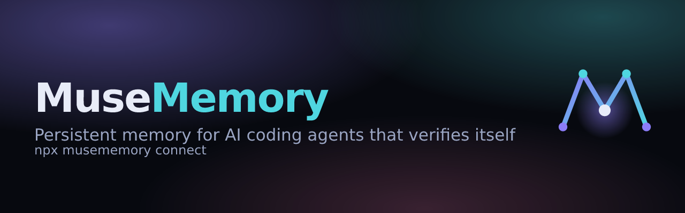

<div align="center">

<a href="#what-muse-memory-does">
  
</a>

<br />
<br />

# 🧠 Muse Memory


-black?style=for-the-badge&logo=bun)


**Persistent, local-first memory for AI agents and the projects they work on.**

[Visit the live site](https://harshsinghmp.github.io/musememory/) · [Docs](https://harshsinghmp.github.io/musememory/docs) · [Comparison](https://harshsinghmp.github.io/musememory/compare) · [Agent reference](https://github.com/harshsinghmp/musememory/blob/main/docs/agent-reference.md)

</div>

---

## Start here (60 seconds)

```bash
npx musememory connect     # detect your coding agents and wire the memory server into each
npx musememory doctor      # confirm the store, schemas and agent wiring are healthy
```

That is the whole setup. No account, no API key, no config file, no background
daemon — the store is two plain directories (`.memory/` in your project,
`~/.memory/` globally) that you can read, diff and commit.

Then, in any session with a connected agent:

```bash
memory context --query "how does auth work" --budget 2000
```

**What you get:** a memory that survives the session, is checked against your
real code before it is stored, and is withheld at recall if the code it cites
has since changed.

| | |
| :--- | :--- |
| **Install** | `npx musememory connect` |
| **Requires** | Node.js ≥ 18 or Bun ≥ 1.2 — nothing else |
| **Storage** | `.memory/` (project) + `~/.memory/` (global) |
| **Data leaves your machine** | Never |
| **Cost** | Free, MIT, no telemetry |

---

## What's new

### v3.0.1 — correctness release

Five defects found by a cross-file invariant audit, and a guarantee that the
numbers on this page are the numbers the code produces.

- **Prompt-injection channel closed**: `CURRENT.md` was written with the raw,
  un-stripped constraint text while the stored memory was sanitised. Because
  `CURRENT.md` is replayed into every later prompt, one captured constraint
  could reach every future session. Sanitisation now happens at the sink.
- **Bi-temporal queries answered from the wrong snapshot**: the context cache
  key omitted `as_of`, so "what did we believe in Q1?" could return today's
  answer from a 30-second-old cache entry.
- **Access counter never accumulated**: every read reset it to its baseline,
  which silently disarmed the access-frequency ranking axis.
- **Store could fail its own schema validator**: entries that failed embedding
  were permanently reported as corrupt.
- **Tier token budget was declared but never enforced**: 327 tokens against a
  200-token budget.
- **Every published number is now generated from the source** and checked by a
  test, so the site can no longer advertise a figure the code does not produce.

### v3.0.0 — feature release

Closed-loop failure attribution, trajectory fix-pair mining, HOT.md compounding, and LangMem logarithmic frequency ranking.

#### New capabilities
- Scoped failure attribution matching code anchors with decaying strike counters ([#313](https://github.com/harshsinghmp/musememory/pull/313))
- Trajectory fix-pair mining discovering negative lessons from agent error sequences ([#144](https://github.com/harshsinghmp/musememory/pull/144))
- Active working set compounding and candidate scoring directly from HOT.md ([#314](https://github.com/harshsinghmp/musememory/pull/314))
- Multi-channel knowledge distillation router across system, content, and health ([#324](https://github.com/harshsinghmp/musememory/pull/324))
- Pre-mutation 30-snapshot rolling ring buffer for zero-daemon recovery ([#177](https://github.com/harshsinghmp/musememory/pull/177))

#### Bug fixes
- In-lock mutation safety guards preventing bulk deletion and semantic erosion ([#50](https://github.com/harshsinghmp/musememory/pull/50))
- Strict CodeAnchor field alignment and dispute tracking type safety ([#325](https://github.com/harshsinghmp/musememory/pull/325))

#### Improvements
- LangMem logarithmic frequency rank curve with 2x application weighting ([#315](https://github.com/harshsinghmp/musememory/pull/315))
- Diff-preserving CURRENT.md checkpoint merge semantics for agent handoffs ([#324](https://github.com/harshsinghmp/musememory/pull/324))
- Constitutional immunity defending non-negotiable rules against strike decay ([#313](https://github.com/harshsinghmp/musememory/pull/313))

*For earlier releases, see the [Changelog](./CHANGELOG.md) or [GitHub Releases](https://github.com/harshsinghmp/musememory/releases).*

---

## 📑 Table of Contents

- [Start here (60 seconds)](#start-here-60-seconds)
- [What's new](#whats-new)
- [What Muse Memory does](#what-muse-memory-does)
- [How it works](#how-it-works)
- [Key capabilities](#key-capabilities)
- [Where your memory lives](#where-your-memory-lives)
- [📖 Documentation map](#-documentation-map)
- [🔄 Complete lifecycle](#-complete-lifecycle-install--verify--connect--uninstall)
- [🔄 Upgrading & self-healing](#-upgrading--self-healing-maintenance)
- [👥 Team & multi-member setup](#-team--multi-member-setup)
- [🏛️ System capabilities & architecture](#-system-capabilities--architecture)
- [🌐 Cognitive Studio dashboard](#-cognitive-studio-dashboard-memory-ui--memory-studio)
- [🔌 CLI & MCP reference](#-cli--mcp-reference)
- [🧠 Shipped agent skills](#-shipped-agent-skills)
- [👤 5 role archetypes](#-5-role-archetypes-usermd)
- [🧪 Testing & verification](#-testing--verification)
- [🔮 Roadmap](#-roadmap)
- [📜 License](#-license)

---

## What Muse Memory does

AI agents lose project context when a session ends. Muse Memory keeps that context on your machine, where your tools can retrieve it during the next task.

Store working constraints, decisions, handoffs, and verified facts in one local memory layer. SQLite handles retrieval, while readable Markdown and YAML files keep the important context inspectable in Git.

```
┌─────────────────────────────────────────────────────────────────────────────┐
│                 AI Agents, Subagent Pods & Autonomous Swarms                 │
│        (Claude Code, Cursor, Antigravity, Windsurf, Codex, CLI)             │
└───────────────────────┬─────────────────────────────────────┬───────────────┘
                        │ MCP stdio / Terminal CLI            │ Local HTTP
┌───────────────────────▼─────────────────────────────────────▼───────────────┐
│                           Muse Memory Core Engine                           │
│                                                                             │
│ ┌──────────────────────┐ ┌──────────────────────┐ ┌───────────────────────┐ │
│ │  Unified Context &   │ │ 5-Pillar Health Gate │ │ Autonomous Cognition  │ │
│ │  Knapsack Retrieval  │ │  & ADR Drift Sentry  │ │   & "Why" Reasoner    │ │
│ └──────────────────────┘ └──────────────────────┘ └───────────────────────┘ │
│ ┌──────────────────────┐ ┌──────────────────────┐ ┌───────────────────────┐ │
│ │   P2P Gossip Sync    │ │  Monorepo Workspace  │ │   Web Observability   │ │
│ │  (Vector Clock Mesh) │ │  Cross-Project Mesh  │ │ Studio (memory studio)│ │
│ └──────────────────────┘ └──────────────────────┘ └───────────────────────┘ │
│ ┌──────────────────────┐ ┌──────────────────────┐ ┌───────────────────────┐ │
│ │ Vibeguard Credential │ │ Dynamic Code Anchors │ │ Universal Migrator    │ │
│ │    Secret Defense    │ │ & Structural Hashes  │ │     (30 Engines)      │ │
│ └──────────────────────┘ └──────────────────────┘ └───────────────────────┘ │
└──────────────────────────────────────┬──────────────────────────────────────┘
                                       │ Atomic SQLite & File I/O
┌──────────────────────────────────────▼──────────────────────────────────────┐
│                     Dual-Scope Storage Engine (.memory/)                    │
│                                                                             │
│  .memory/                                                                   │
│  ├── memory.db          # Primary SQLite database (WAL + FTS5 BM25)         │
│  ├── CURRENT.md         # Real-time working constraints & session handoffs  │
│  ├── USER.md            # Persona archetypes & working style preferences    │
│  ├── sync_pool/         # Zero-daemon shared P2P gossip pool drop folder    │
│  ├── mesh_links.json    # Explicit multi-repo cross-project mesh links      │
│  ├── sync_peers.json    # Peer agent vector clock causal tracking ledger    │
│  ├── audit.jsonl        # Append-only operational audit & compliance trail  │
│  └── memories/          # Dual-persisted human-readable YAML mirror         │
│      ├── m_1700000001000_auth.yaml                                          │
│      └── m_1700000002000_mesh.yaml                                          │
└─────────────────────────────────────────────────────────────────────────────┘
```

---

## How it works

Three steps, on a loop:

1. **Remember it** — when your assistant makes a decision or fixes a bug, Muse
   saves a short note about what changed and why.
2. **Check it** — before the note is stored, Muse confirms the file or function
   it mentions actually exists. Citations are structural fingerprints, not line
   numbers, so a refactor does not silently break the note.
3. **Hand it back** — next time you start work, Muse returns the notes that fit
   the task, sized to your token budget, not the whole archive.

If a saved fact no longer matches your code, Muse leaves it out and says so,
rather than serving it as if it were still true.

---

## Key capabilities

- 👤 **Persona & Style Grounding (`USER.md`)**: Configures your role (`developer`, `designer`, `marketer`, `casual`, `custom`) and communication preferences so AI models write code that matches your style.
- 📐 **Real-Time Active Constraints (`CURRENT.md`)**: Bi-temporal working constraints and invariant tracking synchronized on every mutation to eliminate amnesia during task handoffs.
- 💾 **SQLite Primary + Dual-Persisted YAML Mirror**: Sub-millisecond queries via SQLite with transparent human-readable `.yaml` files in `.memory/memories/` for seamless Git diffs.
- ⚖️ **Token Knapsack Retrieval**: Multi-factor scoring (applicability, verification bonus, AST graph overlap, time decay, due date urgency) tightly packed under prompt token ceilings.
- 🧭 **Optional Local Semantic Recall (`memory embed`)**: Point `retrieval.embedderUrl` at any OpenAI-compatible `/v1/embeddings` endpoint (llama.cpp server, Ollama, or hosted) to add a semantic cosine dimension to ranking. Embeddings are cached as float32 blobs inside SQLite, so nothing changes and no network call happens until you configure an endpoint.
- 🌐 **Pluggable AST CodeGraph & Symbol Indexing**: Native CodeGraph & Graphify integration that indexes codebase AST symbols, auto-tags memories, and awards graph overlap bonuses.
- 🌳 **Hierarchical Tree Retrieval & Progressive Disclosure**: Sharded tree partitions with 3-tier progressive disclosure (`L1` abstracts, `L2` summaries, `L3` full context) for massive knowledge bases.
- 📚 **Obsidian Markdown Wiki & Entity Graph Compiler**: Dual-persistence knowledge compounding compiling linked Markdown pages (`wiki/concepts/`, `wiki/entities/`) with bidirectional `[[wikilinks]]`.
- 🛡️ **Vibeguard Zero-Leakage Secret Scanner**: Regex-powered memory defense intercepting and rejecting API keys, AWS credentials, private keys, database URIs, and passwords before writes.
- 🔌 **Zero-Permission Auto-Wiring (52 Agents)**: Automatically detects and wires Claude Code, Cursor, Antigravity, Windsurf, OpenCode, Codex, Gemini CLI, Hermes, etc.
- 🔄 **Universal Memory Migrator (30 Engines)**: One-click migration from Letta, Mem0, Supermemory, Cognee, Beads, Mnemosyne, GBrain, and more with state preservation.
- 🎨 **Cognitive Studio Visual Dashboard (`memory ui`)**: Embedded zero-dependency web interface featuring 3D force-directed knowledge graphs, live `CURRENT.md` monitor, wiki reader, and persona editor.
- ⏰ **Proactive Nudges & Routines Scheduler**: Cron-invoked daily briefings, staleness policy tracking, and ambient open-loop trackers with zero resident background daemons.

---

## Where your memory lives

Everything Muse knows is a folder you can open, read, diff, back up, or commit.

```
.memory/                                  # project scope — travels with your repo
├── memory.db                             # SQLite: memories, anchors, graph edges, audit
├── memories/                             # one YAML file per memory — plain text, reviewable
├── CURRENT.md                            # active constraints, injected every session
├── USER.md                               # your persona and working preferences
├── observations.jsonl                    # append-only event log the harvester mines
├── audit.jsonl                           # tamper-evident write log
└── sync_pool/                            # zero-daemon shared gossip pool
~/.memory/                                # global scope — preferences that follow you
```

There is no server, no port, and no service to keep alive. Delete the folder
to delete the memory.

---

## Start with one command

> [!TIP]
> ### Install without a global package
> Set up the memory store and connect your local AI agents with one command:
>
> ```bash
> npx musememory install
> # (or with Bun: bunx musememory install)
> ```
>
> This command automatically:
> 1. Initializes the SQLite primary database (`.memory/memory.db`) and `CURRENT.md` constraints file.
> 2. Auto-detects all installed AI coding agents on your machine.
> 3. Auto-wires the memory MCP server into installed agents with zero-permission auto-approval.
> 4. Scans for existing memory stores (Letta, Mem0, Beads, Supermemory, etc.) for instant migration.
>
> **Verify anytime**: `npx musememory doctor`  
> **Explore Studio UI**: `npx musememory ui` (Opens cognitive studio on port 2222)

---

### 📦 Persistent Installation Options

```bash
# Option A: Global Install with NPM or Bun (Recommended)
npm install -g musememory
# or with Bun:
bun add -g musememory

# Option B: One-Line Shell Installer
curl -fsSL https://raw.githubusercontent.com/harshsinghmp/musememory/main/scripts/install.sh | bash

# Option C: Docker Container
git clone https://github.com/harshsinghmp/musememory.git && cd musememory
docker build -t musememory .
```

---

## 📖 Documentation map

Two layers, on purpose. **Human docs** are narrative and explain *why*.
**Agent docs** are contracts: exact commands, exact tool names, exact failure
behaviour, with nothing to interpret. An agent should never have to read a
prose paragraph to learn a flag name.

### For agents — read these

| Document | What it gives you |
| :--- | :--- |
| **[Agent reference](docs/agent-reference.md)** | The contract: install, file layout, mandatory session protocol, trust gates, failure semantics. |
| **[CLI & MCP reference](docs/cli-reference.md)** | Every command and every MCP tool, generated from the source. |
| **[`mcp-tool-matrix.json`](docs/mcp-tool-matrix.json)** | The tool list as JSON, for programmatic consumption. |
| **[`claims.json`](claims.json)** | Every countable claim, generated from `src/` — tool, platform and test counts. |
| **[`llms.txt`](https://harshsinghmp.github.io/musememory/llms.txt)** | The website, for agents. `llms-full.txt` is the whole site as plain text. |

### For humans

| Guide | Intent & Framework | Target Audience |
| :--- | :--- | :--- |
| 🧠 **[Core Concepts & Architecture](docs/concepts.md)** | **ACCA Framework**: Explains the guarded 7-state lifecycle machine, dual-scope engine, knapsack scoring, and zero-daemon architecture. | Tech Leads, Architects, Evaluators |
| 🛡️ **[Failure Attribution & Negative Mining](docs/failure-attribution-and-negative-mining.md)** | **QUEST Framework**: Scoped attribution, decaying strikes, trajectory fix-pair mining, HOT.md compounding, and logarithmic frequency ranking. | AI Engineers, Systems Architects |
| 🛠️ **[Developer Daily User Guide](docs/user-guide.md)** | **QUEST Framework**: The 3-phase daily pair-programming loop (`/muse-ground` → `CURRENT.md` → `/muse-capture`). | Solo Developers, Daily AI Coders |
| ⚡ **[Retrieval Performance & Guardrails](docs/retrieval-performance-and-limits.md)** | **QUEST Framework**: WeakMap token sets, memoized runtime anchors, dirty-gating, limit clamping, and dry-run safety. | Platform Engineers, AI Architects |
| 🏛️ **[Living Architecture & Drift Auditing](docs/living-architecture-and-drift.md)** | **ACCA Framework**: Binding ADRs to line-independent code anchors, write-time `base_path` normalization, and pure read-path drift sentry. | System Architects, Tech Leads |
| ⚡ **[Real-Time Daemon & Observability](docs/daemon-and-observability.md)** | **QUEST Framework**: Real-time SSE event hub (`memory daemon`), CI upgrade gates (`--check`, `--strict`), and PageIndex depth parameters. | Swarm Engineers, DevOps, Builders |
| 👥 **[Team Quickstart & Deployment Guide](docs/team-getting-started.md)** | Single-host server deployment, systemd/Docker setups, and per-editor client recipes (Cursor, Opencode, Claude Code, Antigravity, Windsurf). | Engineering Managers, Team Leads |
| 🏛️ **[Team Slice Wiring & Architecture](docs/architecture/team-slice-wiring.md)** | Technical deep-dive into in-process SQLite WAL vs corrupted network mounts. | Infrastructure Engineers, Systems Architects |
| 📊 **[Capability Comparison](https://harshsinghmp.github.io/musememory/compare)** | 14-capability comparison of local-first memory against vector stores, graph platforms and session search. | Decision Makers, Evaluators |

---

## 🔄 Upgrading & Self-Healing Maintenance

Keep Muse Memory and all your connected AI coding agents at peak cognitive performance with automated updates and self-healing environment repairs.

### ⚡ 1-Command Autonomous Upgrade (`memory upgrade`)

Run `memory upgrade` (or `npx musememory upgrade`) to trigger the **Gamified Level-Up Matrix**:

```bash
memory upgrade
# or with NPX zero-install:
npx musememory upgrade
```

#### What `memory upgrade` automatically handles:
1. **Package Manager Auto-Detection**: Detects whether your workstation runs `bun`, `npm`, `pnpm`, or `yarn` and pulls the latest published binary.
2. **Self-Healing Storage Repair**: Recovers missing `.memory/`, `CURRENT.md` constraints, or `USER.md` persona files if corrupted or deleted.
3. **52 Agent Platform Re-Discovery**: Scans for newly installed coding agents (Cursor, Claude Code, Windsurf, OpenCode, Codex, Gemini CLI, Hermes, etc.) and auto-wires them with zero permissions.
4. **AST Symbol Graph Re-Indexing**: Re-synchronizes CodeGraph/Graphify symbol caches under `.memory/graph-symbols.json`.

---

### 📦 Manual Package Manager Upgrades

| Toolchain / Runtime | Upgrade Command | Verification |
| :--- | :--- | :--- |
| **Bun** (Ultra-Fast) | `bun add -g musememory@latest` | `memory doctor` |
| **NPM** (Standard Node) | `npm install -g musememory@latest` | `memory doctor` |
| **PNPM** | `pnpm add -g musememory@latest` | `memory doctor` |
| **Yarn** | `yarn global add musememory@latest` | `memory doctor` |
| **NPX** (Zero-Install) | `npx musememory@latest upgrade` | `npx musememory doctor` |

```bash
# Check if updates are available without applying (exits 0 if up to date, 1 if registry fails)
memory upgrade --check

# Enforce up-to-date installation in CI pipelines (exits 1 if update is available)
memory upgrade --check --strict

# Preview upgrade actions in dry-run mode
memory upgrade --dry-run

# Force re-installation and complete platform re-wiring
memory upgrade --force
```

---

## 🔄 Complete Lifecycle (Install → Verify → Connect → Uninstall)

Every command works with **zero installation** via `npx musememory <cmd>` (or `bunx musememory <cmd>`). Use plain `memory <cmd>` if installed globally.

### 1️⃣ Install & Auto-Wire
```bash
# Full setup: init .memory/, detect agents, wire MCP, scan for migratable stores
npx musememory install

# Initialize workspace only (no agent wiring)
npx musememory init
```

### 2️⃣ Verify & Health Check
```bash
# Comprehensive ecosystem diagnostic (storage, schemas, secrets, MCP wiring)
npx musememory doctor

# Memory store breakdown and active briefing
npx musememory stats
npx musememory briefing
```

### 3️⃣ Connect Coding Agents (52 Platforms)
```bash
# Scan workstation for installed AI coding agents
npx musememory agents

# Auto-wire all detected agents with zero permissions
npx musememory connect all

# Wire one specific agent explicitly
npx musememory connect claude-code
npx musememory connect cursor
npx musememory connect antigravity
npx musememory connect windsurf
npx musememory connect opencode

# Claude Code lives under ~/.claude*, so it needs an explicit harness opt-in.
# Without this flag the Claude config is reported as skipped and nothing is written.
npx musememory connect claude-code --harness claude
```

### 4️⃣ Clean Uninstallation & Removal

<details>
<summary><b>🗑️ Complete Uninstallation & System Removal Steps</b> — <i>Click to expand</i></summary>

Muse Memory can be cleanly and completely removed with zero trace left on your machine.

#### Step 1: Unwire Coding Agents (Zero-Trace MCP Cleanup)
Remove the memory MCP server configuration from every detected agent config file (`cursor`, `claude-code`, `antigravity`, `windsurf`, `opencode`, `codex`, etc.):

```bash
# Preview changes before modifying any configuration
npx musememory uninstall --dry-run

# Unwire all detected AI coding agents automatically
npx musememory uninstall

# Or unwire a single specific agent
npx musememory uninstall cursor
```

#### Step 2: Purge Memory Data & Stores (Optional)
By default, `uninstall` preserves your project `.memory/` data. To completely delete all memory files and databases:

```bash
# Unwire agents AND purge local project .memory/ directory
npx musememory uninstall --purge

# Remove global user profile and global memory store (~/.memory/)
npx musememory uninstall --global --purge

# Manual cleanup (equivalent):
rm -rf .memory/           # Local project store
rm -rf ~/.memory/          # Global user profile & store
```

#### Step 3: Remove Globally Installed Package
If you installed `musememory` globally via a package manager:

```bash
# If installed via npm:
npm uninstall -g musememory

# If installed via bun:
bun remove -g musememory

# If installed via yarn / pnpm:
pnpm remove -g musememory
yarn global remove musememory
```

#### Step 4: Clean Git Hooks & Directives (Optional)
If you installed the pre-commit transcript harvester hook or injected agent prompt directives:
- **Git Hook**: Delete `.git/hooks/pre-commit` (or restore your previous hook).
- **AGENTS.md**: Remove the `<!-- musememory:start --> ... <!-- musememory:end -->` block from your project's `AGENTS.md` file.

</details>

---

## 👥 Team & Multi-Member Setup

Deploy a shared persistent cognitive memory layer across your entire engineering team. All team members' coding agents (Cursor, Opencode, Claude Code, Antigravity, Windsurf) connect to a single host server running in-process SQLite over **MCP Streamable HTTP (2025-06-18)** with Bearer token authentication.

```
                    Central Team Server (`team.db` + `CURRENT.md`)
                                       ▲
                                       │ MCP Streamable HTTP (Bearer Auth)
         ┌───────────────────┬─────────┴─────────┬───────────────────┐
      Cursor              Opencode          Antigravity         Claude Code
```

### 1-Line Team Server Start
Run on your team's internal VM, build server, or workstation:
```bash
# Start server with individual or shared Bearer auth tokens
musememory serve --port 31338 --host 0.0.0.0 --tokens alice:tok_alice_123,bob:tok_bob_456
```

### 1-Line Client Recipe Generator
Generate ready-to-paste configurations tailored to each engineer's specific editor:
```bash
# Interactive editor selector
musememory connect

# Or output directly into console:
musememory connect --recipe --endpoint http://192.168.1.50:31338/mcp --token tok_alice_123
```

### Complete Getting Started & Architecture Guide
For full server setup (systemd service, Docker, reverse proxy), editor-specific client JSON configs, team memory scoping rules (`team.db` vs personal `tenant_<id>.db`), and prompt injection defenses, see:
- 👉 **[Team Quickstart & Deployment Guide](docs/team-getting-started.md)** — Step-by-step setup for Team Leads and Engineers.
- 👉 **[Team Slice Wiring & Architecture Spec](docs/architecture/team-slice-wiring.md)** — Technical deep dive into in-process SQLite vs networked mounts.

---

## 🏛️ System Capabilities & Architecture

### 1. Dual-Scope Storage (Local vs Global)
- **Local Workspace (`<project>/.memory/`)**: Repository-specific architectural decisions, bug fixes, active `CURRENT.md` constraints, and session timeline nodes.
- **Global System (`~/.memory/` via `--global` / `-g`)**: Universal developer preferences, cross-repo coding conventions, and global prompt patterns.

### 2. Deterministic 7-State Lifecycle Machine & Audit Ledger
All memory entries transition through a guarded state machine:
```
  [propose] ──► candidate ──► confirm() ──► confirmed ──► supersede() ──► superseded
                    │                           │
                    ├──► markStale() ───────────┤
                    │         │                 │
                    │         ▼                 ▼
                    └──►    stale            rejected
                              │
                              └──► delete() ──► [Purged from Disk + audit.jsonl logged]
```
Every mutation (`propose`, `confirm`, `supersede`, `mark_stale`, `reject`, `delete`, `link`) writes an immutable log record to `.memory/audit.jsonl`.

### 3. Knapsack Token Budgeting & Multi-Factor Scoring
Retrieval dynamically ranks knowledge using a calibrated multi-factor formula:
$$\text{Score} = 1.0 \times \text{Applicability} + \text{StatusBonus} + \text{VerificationBonus} + \text{GraphBonus} + \text{SalienceBonus} + 0.3 \times e^{-\frac{\Delta t}{90\text{ days}}}$$
The engine greedily packs ranked memories up to the requested `--token-budget` to guarantee zero prompt overflow.

When a local embedder is configured (`retrieval.embedderUrl`), a semantic cosine dimension (`0.5 ×` cosine similarity) joins the ranking, so paraphrases match even without shared trigrams. Leave the embedder unset and ranking is identical to the lexical behaviour above — no network calls, no new dependency.

### 4. Real-Time `CURRENT.md` Synchronization & Session Handoff
- Active constraint memories automatically mirror into `CURRENT.md`.
- In-flight task states, agent checkpoints, and active loops persist across terminal restarts, context compactions, and sudden interruptions.

### 5. Unified Compounding: Obsidian Wiki & Entity Graph
- **Obsidian Wiki Compiler (`memory wiki`)**: Compiles confirmed memory clusters into linked Markdown pages (`wiki/concepts/`, `wiki/entities/`) with bidirectional `[[slug]]` wikilinks.
- **Named Entity Extraction (`memory entities`)**: Automatically extracts persons, products, organizations, tools, and code symbols with co-occurrence edge weights.
- **PageIndex Reasoning Engine (`memory pageindex`)**: Indexes unstructured documents into hierarchical reasoning trees.

### 6. Universal Migration Engine (30 Memory Formats)
Auto-detects and ingests existing memory stores across 29 external engines:
```bash
# Auto-detect all external memory stores on your machine
memory detect

# Ingest and preserve state mappings
memory migrate --provider letta
memory migrate --provider mem0
memory migrate --provider beads
memory migrate --all
```
> See the live [capability comparison](https://harshsinghmp.github.io/musememory/compare) for the published page, and [`docs/research/musememory-comparison.html`](docs/research/musememory-comparison.html) for the research survey dossier (68 systems).

---

## 🌐 Cognitive Studio Dashboard (`memory ui` / `memory studio`)

Muse Memory includes an embedded, zero-dependency visual graph studio and observability dashboard:

```bash
memory studio
# or alias:
memory ui --port 2222
```

Navigate to `http://localhost:2222` to access:
- 🌐 **3D Force-Directed Knowledge Graph**: Orbital canvas physics, degree-scaled node radii, and link relationship viewer.
- 🏥 **5-Pillar Project Health Gate**: Live architectural scorecard (Store Integrity, Native Anchors, Doc-Code Alignment, Anti-Pattern Sentry, Technical Debt) with A-F grading and PASS/WARN/FAIL status.
- 🏛️ **ADR Registry & Drift Inspector**: First-class Architecture Decision Records and bi-directional code ↔ documentation drift auditor.
- 🤔 **Autonomous "Why" Reasoner**: Traces historical evolution of symbols/files backwards through past bug fixes and trade-offs to explain architectural rationale before refactoring.
- 🤝 **P2P Gossip Mesh Topology**: Real-time peer vector clocks, local agent identity, and one-click broadcast/shared pool sync.
- 🕸️ **Monorepo & Cross-Project Mesh**: Workspace monorepo topology (pnpm, npm, bun, lerna), discovered package nodes, cross-project memory query, and contract drift audit.
- ⚡ **Active Invariants & Real-Time Handoff**: Live `CURRENT.md` monitor tracking in-flight session status and agent checkpoints.
- 📚 **Obsidian Wiki Browser**: Concept and entity page reader with full Markdown rendering.
- 👤 **Persona Studio (`USER.md`)**: 5 archetype picker (`developer`, `designer`, `marketer`, `casual`, `custom`) and live editor.
- 🔍 **Knapsack Retrieval Sandbox**: Interactive token budget simulator (500–6,000 tokens) with live prompt context generation.
- 📜 **Compliance Audit Ledger**: Live tabular feed of state transitions and audit logs.

---

## 🔌 CLI & MCP reference

<details>
<summary><b>🔌 CLI & MCP reference (generated from source)</b> — <i>Click to expand</i></summary>

The complete command and tool surface is **generated from `src/`**, not
transcribed by hand, so it cannot drift:

| Document | Contents |
| :--- | :--- |
| **[`docs/cli-reference.md`](docs/cli-reference.md)** | Every CLI command with its flags, and every MCP tool with its required parameters — grouped by purpose. |
| **[`docs/mcp-tool-matrix.json`](docs/mcp-tool-matrix.json)** | The MCP tool list as JSON, for programmatic consumption. |
| **[`docs/agent-reference.md`](docs/agent-reference.md)** | The contract an agent must follow: session protocol, trust gates, failure semantics. |
| **[`claims.json`](claims.json)** | Every countable claim, generated from `src/`. |

### The commands you will actually use

```bash
memory context [query] --token-budget N   # top-ranked context for prompt injection
memory search <query> --limit N           # ranked search with a score breakdown
memory capture "<text>" --project P       # persist a memory (secret-scanned, citation-verified)
memory propose "<text>" --project P       # propose a candidate without confirming it
memory confirm <id>                       # promote a candidate to confirmed
memory supersede <old_id> --with <new_id> # replace outdated knowledge, keep lineage
memory current get | set "<text>"         # read/write active constraints
memory link <id> --related <id1,id2>      # bidirectional relation between entries
memory audit [--operation OP]             # query the append-only audit ledger
memory doctor                             # full ecosystem health diagnostic
memory health                             # 5-pillar health gate with a letter grade
memory verify <id> --strict               # run an entry's verification command
memory harvest "<text>" --project P       # distil a turn into a fix/decision unit
memory wiki compile                       # compile memories into an Obsidian wiki
memory benchmark                          # measured speed, quality and token-economy report
```

### The MCP tools you will actually use

| Tool | When |
| :--- | :--- |
| `get_context` | **First turn of any session.** Persona, constraints, top-K memories. |
| `muse_context` | Task-shaped fused context (constraints + memories + negative lessons + anchors). |
| `memory_capture` | Right after a fix, a decision, or a new constraint. |
| `memory_supersede` | When knowledge is replaced — never `delete`. |
| `search` / `memory_tree_search` | Investigating what is already known. |
| `muse_why` | Before a refactor: why is the code like this? |
| `muse_code_impact` | Before touching a file: what depends on it? |
| `memory_audit` | When you need to know who changed what, and when. |
| `muse_profile_list` | Which tools are exposed in the current profile. |

Tools are exposed through 7 task-focused profiles (`core`, `coding`,
`debugging`, `review`, `architecture`, `maintenance`, `full`) so an agent is
never handed the whole surface. Select one with `MUSE_MCP_PROFILE`.

</details>

<details>
<summary><b>🧠 Shipped agent skills (<code>.agents/skills/</code>)</b> — <i>Click to expand</i></summary>

Muse Memory ships with 11 turnkey Agent Skills designed for coding agents (Claude Code, Cursor, Antigravity, OpenCode, Codex, Gemini CLI, etc.) under `.agents/skills/`:

| Skill | Trigger Phase | Core Agent Responsibility |
| :--- | :--- | :--- |
| [`muse-ground`](.agents/skills/muse-ground/SKILL.md) | **Session Start** | Retrieves Top-$K$ relevant memories, active `USER.md` persona profile, and `CURRENT.md` constraints before writing code. |
| [`muse-capture`](.agents/skills/muse-capture/SKILL.md) | **During Fixes & Refactors** | Captures atomic fix/architecture memories, validates evidence, runs Vibeguard secret scan, and supersedes obsolete knowledge. |
| [`muse-current`](.agents/skills/muse-current/SKILL.md) | **Invariants & Handoffs** | Synchronizes hard constraints into `.memory/CURRENT.md` and persists structured handoffs across context resets. |
| [`muse-health`](.agents/skills/muse-health/SKILL.md) | **Hardening Gates & PRs** | Evaluates 5-pillar architectural health (store, anchors, doc/code alignment, negative sentry, debt) and outputs remediation checklists. |
| [`muse-drift`](.agents/skills/muse-drift/SKILL.md) | **System Architecture & ADRs** | Audits documentation $\longleftrightarrow$ code drift across 6 states, records living ADRs, and supersedes legacy architectural decisions. |
| [`muse-why`](.agents/skills/muse-why/SKILL.md) | **Refactoring & Historical Context** | Reconstructs historical rationale, synthesizes past bug fixes and accepted trade-offs, and audits recurring bug friction clusters. |
| [`muse-sync`](.agents/skills/muse-sync/SKILL.md) | **Multi-Agent & Swarm Gossip** | Coordinates cross-agent knowledge sync with whole-packet SHA-256 integrity, vector clocks, and P2P gossip mesh pool. |
| [`muse-mesh`](.agents/skills/muse-mesh/SKILL.md) | **Monorepo & Multi-Repo Mesh** | Discovers monorepo workspaces, resolves cross-package memories with badges, and propagates shared security constraints. |
| [`muse-graph`](.agents/skills/muse-graph/SKILL.md) | **AST Code Investigation** | Indexes `.codegraph`/`.graphify` symbols and queries symbol-matching decisions with `+0.2` graph overlap bonus. |
| [`muse-wiki`](.agents/skills/muse-wiki/SKILL.md) | **Knowledge Compounding** | Compiles confirmed memories into Obsidian-compatible Markdown pages (`[[wikilinks]]`) and entity co-occurrence graphs. |
| [`muse-brief`](.agents/skills/muse-brief/SKILL.md) | **Daily Hygiene & Loops** | Generates morning briefings, tracks 90/180-day staleness decay, and surfaces unresolved transcript commitments. |

</details>

<details>
<summary><b>👤 5 Zero-Fingerprint Role Archetypes (`USER.md`)</b> — <i>Click to expand</i></summary>

Muse Memory maintains a persistent user profile (`~/.memory/USER.md` globally, or `.memory/USER.md` locally) to ground AI agents in your working style:

1. **`developer`** (Default): Code-first, direct, concise, runnable diffs, strict types, fail-fast mechanics.
2. **`designer`**: Visual hierarchy, CSS/Tailwind systems, GSAP animations, WCAG accessibility, Figma/tokens design tokens.
3. **`marketer`**: Conversion-rate optimization (CRO), punchy benefit-driven copy, SEO clustering, audience hooks.
4. **`casual`**: Plain English, jargon-free explanations, step-by-step guidance.
5. **`custom`**: Clean blank template ready for personalized instructions.

```bash
# View active profile
memory user get

# Initialize with a specific archetype
memory user init developer
memory user init designer --global

# Update user profile
memory user set "- Prefers TypeScript, Bun, and ultra terse responses"
```

</details>

---

## 🧪 Testing & Verification

```bash
bun install
bun test          # 1335 pass, 0 fail, 6123 assertions across 205 files
bun run typecheck # 0 static type errors
bun run build     # Clean bundled distribution build (dist/index.js)
```

See [CONTRIBUTING.md](./CONTRIBUTING.md) for the branch/PR model, the per-commit gate, and the post-merge sequence.

---

## 🔮 Roadmap

Work moves through four phases — requested → planned → in progress → done —
and ships as a pull request from `dev` to `main`.

| Phase | Status |
| :--- | :--- |
| 📋 Requested | 4 items in the backlog |
| 📅 Planned | 7 confirmed features scheduled |
| ⚡ In progress | none — sprint SOW-200 shipped |
| ✅ Done | shipped to production |

**[Full roadmap →](docs/roadmap.md)** · [Live issues & milestones](https://github.com/harshsinghmp/musememory/issues) · [CHANGELOG](CHANGELOG.md)

---

## 📜 License

MIT License. Built for the AI Developer Ecosystem.
